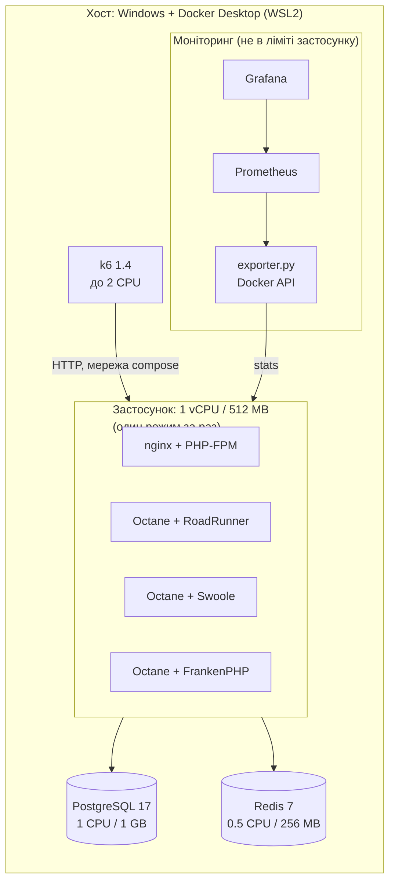
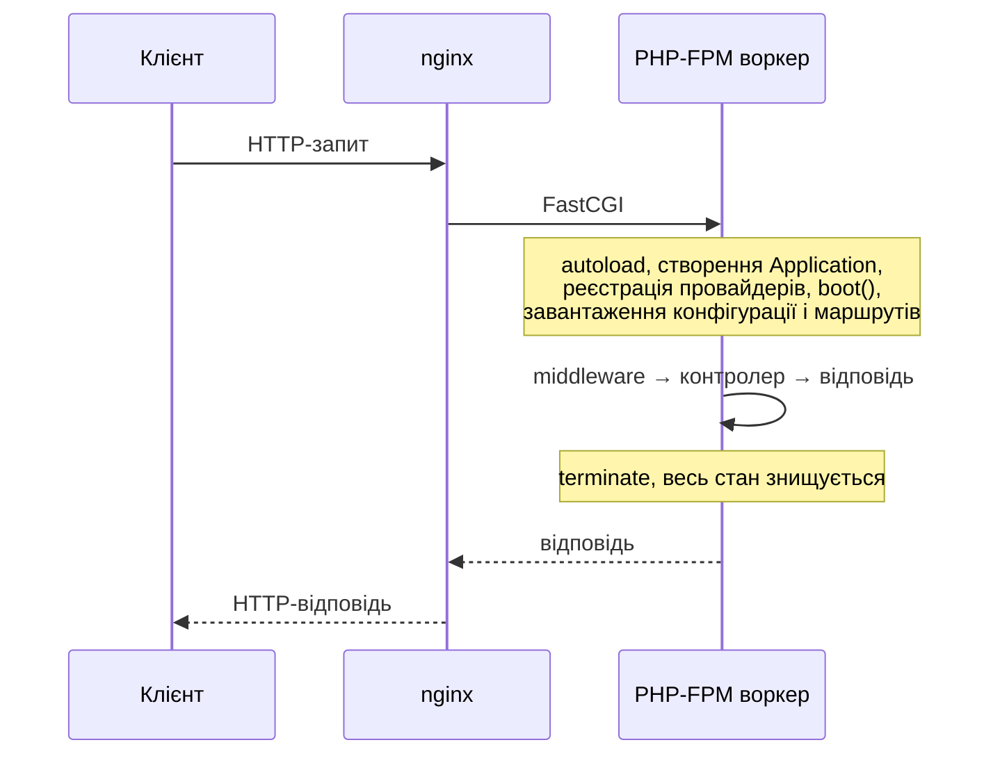
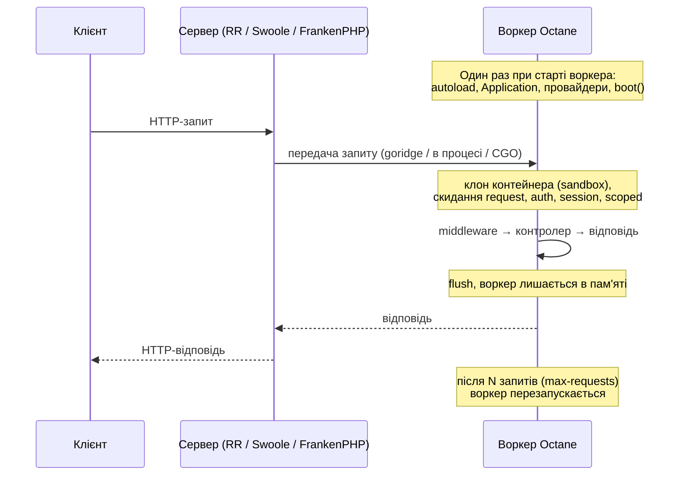

# Методика експерименту

Документ описує стенд, параметри і процедуру вимірювань так, щоб експеримент можна було відтворити
на іншій машині й отримати співставні (у відносних величинах) результати.

## 1. Мета і гіпотези

Мета: порівняти продуктивність одного й того самого Laravel-застосунку в чотирьох режимах запуску:

| Режим | Модель виконання |
|---|---|
| PHP-FPM + nginx | класична Share-Nothing: фреймворк завантажується на кожен запит |
| Octane + RoadRunner | Go-сервер, довгоживучі PHP-воркери через goridge |
| Octane + Swoole | розширення PHP з власним event loop, воркери в пам'яті |
| Octane + FrankenPHP | Caddy (Go) з вбудованим PHP у worker-режимі |

Гіпотези:

1. На «легких» запитах (ping, автентифікація, кеш) Octane дає кратний приріст RPS, бо зникають витрати на
   bootstrap фреймворку.
2. На запитах, де час визначає БД, різниця між режимами зменшується, бо вузьке місце не в PHP.
3. На обчислювальних запитах (серіалізація, обчислення) приріст помірний: бізнес-логіка однаково
   виконується PHP.
4. Octane потребує більше пам'яті на воркер і чутливий до витоків стану (див. `docs/memory-leaks.md`).

## 2. Стенд



Принципи чесного порівняння:

- **Один код застосунку** для всіх режимів. Режим обирається лише змінною `SERVER_MODE` в entrypoint.
- **Один образ** для FPM, RoadRunner і Swoole (FrankenPHP має власний базовий образ з тим самим PHP 8.4 і тими
  самими розширеннями).
- **Однакові ліміти**: контейнер застосунку 1 CPU / 512 MB у кожному режимі.
- **По одному режиму за раз**: `bench/run.sh` зупиняє інші, щоб вони не конкурували за CPU.
- **Однакові дані**: детермінований сидер (`SEED_RANDOM=42`), БД пересоздається перед прогоном.
- **Однакова конфігурація PHP**: OPcache увімкнений, `validate_timestamps=0`, кеш конфігурації і маршрутів.

## 3. Версії ПЗ

| Компонент | Версія |
|---|---|
| PHP | 8.4 |
| Laravel | 13.x |
| Laravel Octane | 2.x |
| RoadRunner | 2025.1 |
| Swoole | 6.x |
| FrankenPHP | 1.x |
| PostgreSQL | 17 |
| Redis | 7 |
| k6 | 1.4.0 |
| Prometheus / Grafana | 3.5 / 12 |

Точні версії конкретного прогону фіксуються в `bench/results/<дата>/meta.json` (див. також `composer.lock`).
Для тексту диплому беріть значення звідти.

## 4. Життєвий цикл запиту: PHP-FPM і Octane

Різниця, яку вимірює дослідження, видно з діаграм.





У FPM блок «autoload … маршрути» виконується на кожен запит, в Octane лише при старті воркера. Саме це дає
основний приріст на легких запитах і саме це робить можливими витоки стану між запитами.

## 5. Сценарії навантаження

| Сценарій | Маршрут | Що навантажує |
|---|---|---|
| `ping` | `GET /api/ping` | лише фреймворк: базова вартість запиту |
| `auth` | `GET /api/me` (Sanctum-токен) | middleware, запит до БД за токеном |
| `database` | `GET /api/bench/db/orders/{id}`, `/api/bench/db/counterparties/{id}/orders` | Eloquent: звіт по замовленню з позиціями, вибірка замовлень контрагента |
| `cache` | `GET /api/bench/cache/counterparties/{id}`, `POST …/hit` | Redis: read-through кеш статистики, інкременти |
| `compute` | `GET/POST /api/bench/compute/report` | CPU: генерація і серіалізація до 50 000 рядків |
| `mixed` | усі вище у пропорції реального трафіку | змішаний профіль |
| `arrival` | постійна частота запитів | затримки при однаковому навантаженні |
| `soak` | `mixed`, 30 хв | стабільність пам'яті |

Кожен сценарій виконується в закритій моделі (фіксована кількість VU) на рівнях 10, 50, 100, 200, 300, 500 VU.
Відповіді перевіряються (`check`), помилкою вважається будь-яка відповідь, крім 2xx.

## 6. Процедура

1. Підготувати хост (розділ 7).
2. Зібрати образи: `docker compose build`.
3. Перевірити стенд: `./scripts/smoke.sh` (усі режими віддають однакові відповіді, тести проходять).
4. Калібрування воркерів (`bench/config.md`), зафіксувати обрані значення.
5. Основний прогін: `./bench/run.sh`. Для кожного режиму:
   - підняти БД і Redis, накотити міграції і дані, видати токени, прогріти кеш;
   - запустити лише цей режим, прогріти його (`WARMUP_TIME`, 30 s);
   - для кожного сценарію і рівня VU: 5 s прогріву всередині прогону і 60 s вимірювання, 3 повтори;
   - паралельно щосекунди записувати CPU і пам'ять контейнера (`*.stats.csv`, а з моніторингом `*.prom.csv`).
6. Тест пам'яті: `SOAK=1 ./bench/run.sh` і `./bench/leak.sh`.
7. Обробка:
   ```bash
   python3 analysis/parse.py bench/results/<дата>
   python3 analysis/plots.py analysis/results/<дата>
   python3 analysis/economics.py analysis/results/<дата>
   ```
8. Перевірити `analysis/figures/<дата>/tables.md`, перенести графіки і таблиці в текст.

Метрики: RPS (успішні запити за секунду), p50/p95/p99 затримки, частка помилок, середнє CPU і пікова пам'ять
контейнера. Між повторами береться медіана, розкид (min–max) показується на графіках.

## 7. Обмеження і заходи

| Обмеження | Вплив | Захід |
|---|---|---|
| Docker Desktop на Windows працює у віртуальній машині WSL2 | абсолютні числа нижчі і шумніші, ніж на Linux-сервері | порівнюються режими між собою в однакових умовах; код у файловій системі WSL; фіксовані ресурси в `.wslconfig` |
| k6 на тій самій машині | генератор навантаження конкурує за CPU | k6 обмежений 2 CPU, застосунок 1 CPU; хост має мати ≥ 4 ядра |
| Ліміт CPU через CFS quota, а не виділене ядро | можливе throttling | однаковий для всіх режимів; `cpu_pct` у результатах показує, чи застосунок упирався в ліміт |
| Енергозбереження і турбобуст ноутбука | частота CPU «плаває» | живлення від мережі, режим «Максимальна продуктивність», 3 повтори, медіана |
| БД на тому самому хості | у сценарії `database` вузьким місцем може бути PostgreSQL | БД має окремий ліміт 1 CPU / 1 GB; результат інтерпретується як «упирається в БД» |
| Синтетичне навантаження | реальний трафік різноманітніший | сценарій `mixed` і `arrival` наближають профіль до реального |

Висновки дослідження стосуються **відносної** різниці між режимами за однакових ресурсів. Абсолютні
значення RPS на продакшн-сервері будуть іншими.

## 8. Відтворюваність

- Усі параметри задаються змінними оточення і фіксуються в `meta.json` кожного прогону.
- Дані детерміновані, генератор випадкових чисел у k6 і в `ReportCompute` має фіксоване зерно.
- Сирі результати k6 у git не зберігаються (великі), у репозиторії лишаються `analysis/results/<дата>/summary.csv`
  і графіки.
